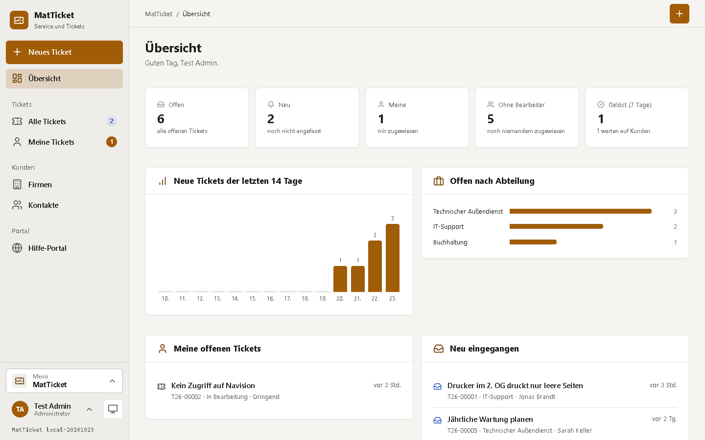
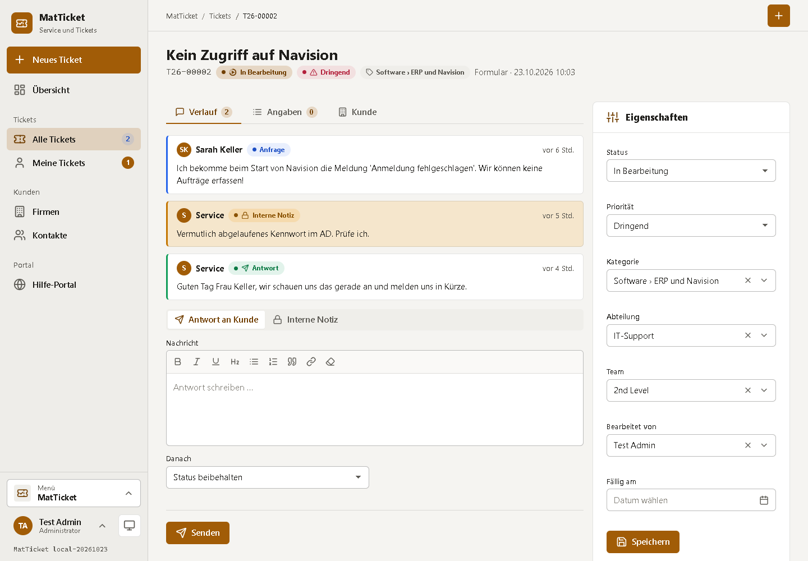
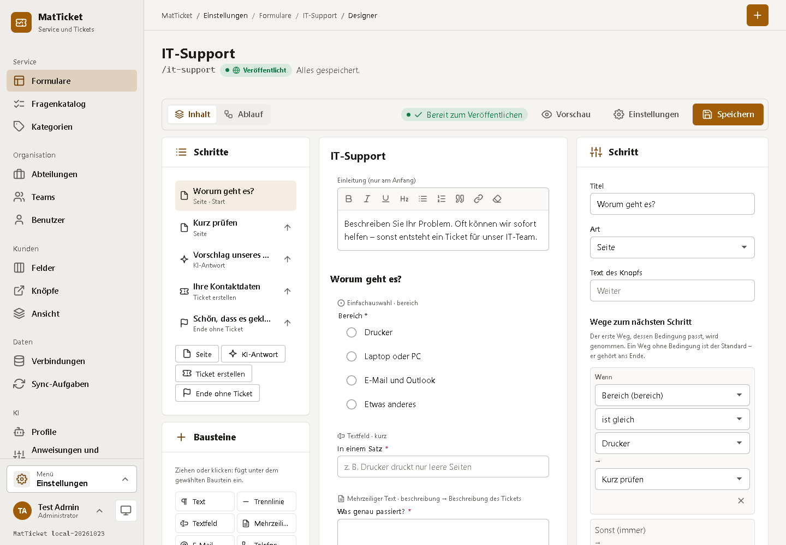
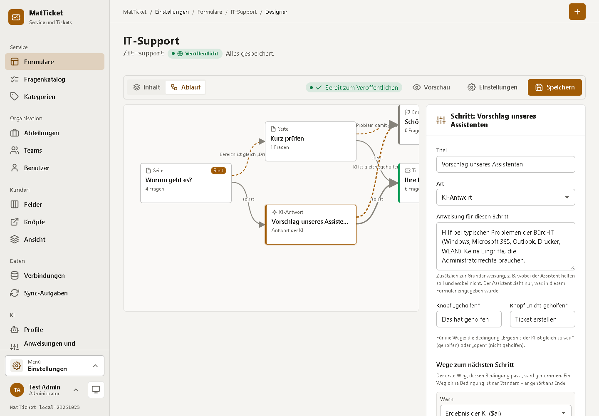
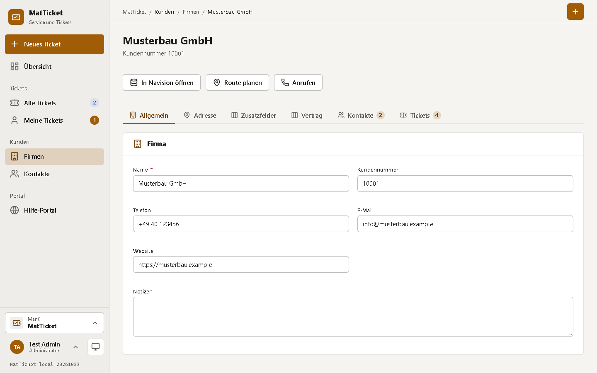
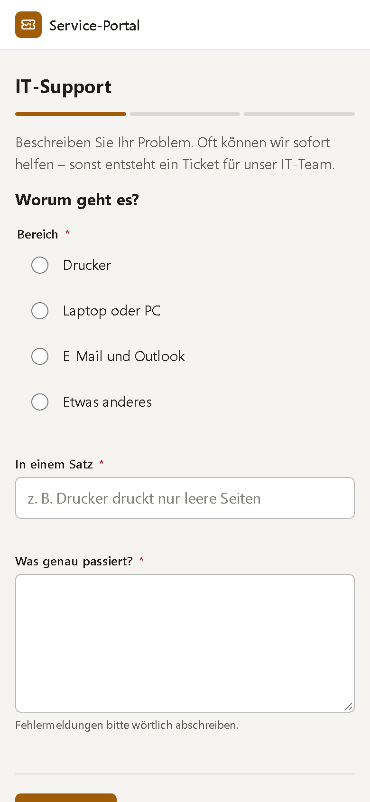
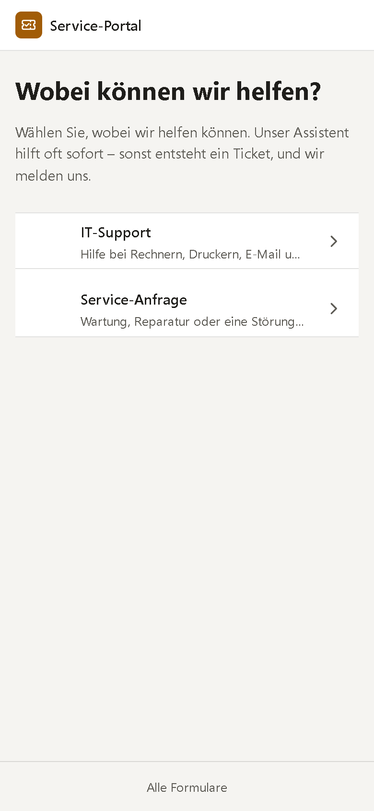
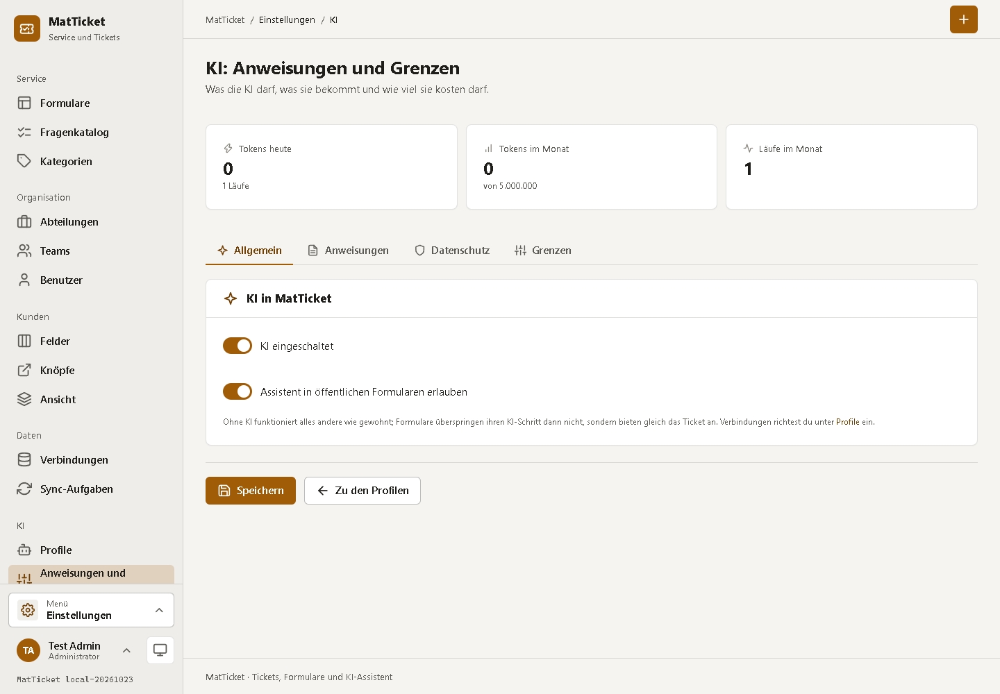

<div align="center">


# MatTicket

**Tickets, Formular-Designer, kleines CRM und KI-Assistent – als installierbare App.**

Service-Mitarbeiter bauen Formulare und Assistenten mit einem WYSIWYG- und Ablauf-Editor und veröffentlichen sie unter `/adresse`.
Kunden bekommen Hilfe zur Selbsthilfe (auch von der KI) – und wenn das nicht reicht, ein Ticket mit eigener Statusseite.
Tickets landen in der richtigen Abteilung und im richtigen Team, Kunden kommen per Sync aus SQL Server, PostgreSQL oder MySQL.

</div>



---

## Auf einen Blick

**Tickets**
- Liste mit Suche, Filtern (Abteilung, Team, Kategorie, Priorität, Bearbeiter) und Sortierung; Reiter für *Offen*, *Neu*, *In Arbeit*, *Wartet auf Kunde*, *Erledigt*
- Ticketseite mit Verlauf, Antwort an den Kunden oder **interner Notiz** (Editor mit Formatierung), Angaben aus dem Formular und dem Kunden aus dem CRM
- **Verschieben** in eine andere Abteilung oder an ein Team (mit Notiz), Übernehmen, Status, Priorität, Fälligkeit – jede Änderung steht im Verlauf
- Mitarbeiter sehen die Tickets der Abteilungen ihrer Teams; Administratoren alles. Geprüft im Business-Layer, nicht nur in der Seite
- Kunden sehen ihr Ticket unter einem geheimen Link (`/t/…`), antworten dort und markieren es als gelöst; Bestätigungen und Antworten per E-Mail

**Formular-Designer**
- **Inhalt (WYSIWYG):** jeder Schritt so, wie Besucher ihn sehen; Texte werden direkt bearbeitet, Bausteine per Ziehen oder Klick eingefügt und verschoben
- 14 Bausteine: Text, Trennlinie, Textfeld, mehrzeilig, E-Mail, Telefon, Zahl, Datum, Auswahl, Einfach-/Mehrfachauswahl, Ja/Nein, **Kategorie**, Zustimmung
- **Fragenkatalog:** Fragen einmal anlegen, in vielen Formularen einfügen
- **Ablauf:** Schritte als Knoten, Wege als Pfeile mit **Bedingungen** (ist gleich, enthält, ist eins von, leer, größer …); Schritt-Arten *Seite*, *KI-Antwort*, *Ticket erstellen*, *Ende ohne Ticket*
- Antworten füllen Name, E-Mail, Betreff, Beschreibung oder Priorität des Tickets; der Betreff kann eine Vorlage sein (`{bereich}: {kurz}`)
- Prüfung vor dem Veröffentlichen, **Versionen** (jede veröffentlichte Fassung bleibt lesbar), Vorschau des Entwurfs, Hilfe-Portal unter `/hilfe`
- **Wer was sieht, ist konfigurierbar:** Zugang pro Formular (öffentlich, nur angemeldet, nur Service, bestimmte Entra-Gruppen), Kategorien nur für Gruppen, Sichtbarkeit pro Baustein (alle, Gäste, Angemeldete, Service)
- **Anmelden zum Anfragen:** Mitarbeiter melden sich (z. B. mit Microsoft) als *Anfragende* an; Name und E-Mail kommen aus dem Konto statt aus dem Formular, ihre Anfragen stehen unter *Meine Anfragen*
- Baustein **Kunde (CRM)**: der Service erfasst eine Anfrage für einen Kunden – die Kundenliste sieht nur der Service, das ist im Code festgelegt

**KI**
- **Profile** statt einzelner Schlüssel (OpenAI, Mistral (EU), DeepSeek, OpenRouter, eigener Server, **ChatGPT-Konto mit Code-Anmeldung**), genau eins aktiv, „Modelle laden“ fragt den Anbieter
- Antwortvorschlag für Mitarbeiter, Einordnen von Tickets (rückgängig machbar), automatische Erstantwort, **Assistent im Formular**
- Anweisungen in Schichten (Betreiber → Website → fester Teil → Lage), „Vollständige Anweisung anzeigen“
- Grenzen pro Mitarbeiter/Tag, Monat, Besucher (täglich wechselnder Hash) und Adresse; jeder Lauf mit jedem Schritt protokolliert, Journal mit **Rückgängig**
- Schlüssel und Anmeldungen verschlüsselt im Datenvolume – nie in der Datenbank, nie in einem Backup, nie im Browser

**Kleines CRM und Sync**
- Firmen und Kontakte mit **eigenen Feldern** (auf eigenen Reitern), frei wählbaren Spalten und ausblendbaren Feldern
- **Knöpfe** in andere Systeme mit Platzhaltern: Navision, das Haupt-CRM, **Google Maps** (Karte lädt erst auf Klick), Anrufen, E-Mail
- **Sync-Aufgaben:** Verbindung (SQL Server, PostgreSQL, MySQL), SELECT, Schlüsselspalte, Zuordnung Spalte → Feld, Takt, Vorschau, Läufe

**Anmeldung**
- **Microsoft Entra ID** zuerst („Mit Microsoft anmelden“), das Passwort bleibt als Notzugang; Einrichtung im Admin-Bereich ohne Neustart
- Gruppen → Rollen (Administrator, Service, Anfragender); nur Mitglieder eingetragener Gruppen kommen hinein – oder auf Wunsch alle anderen Konten des Tenants als Anfragende. Fehler werden auf der Anmeldeseite erklärt, eine falsche Einrichtung legt die App nie lahm
- Lokale Konten mit zweitem Faktor (Authenticator-App), Sitzungen in der Datenbank

**App**
- Vollwertige **PWA**: Manifest, Service Worker, installierbar, iOS-Statusbar und Safe Areas, Offline-Hinweis mit automatischem und manuellem Neuverbinden, zuletzt geöffnete Seiten offline lesbar
- Design aus **MatDesign** (MatUi 0.9.2), hell und dunkel, jede Seite auf dem Handy geprüft
- `robots.txt`, Sitemap und [`llms.txt`](https://llmstxt.org/) nur mit den öffentlichen Formularen

## Screenshots

| Ein Ticket | Der Designer: Inhalt |
|---|---|
|  |  |

| Der Designer: Ablauf | Eine Firma mit Knöpfen |
|---|---|
|  |  |

| Ein Formular auf dem Handy | Das Hilfe-Portal | KI: Anweisungen und Grenzen |
|---|---|---|
|  |  |  |

## Starten

```bash
docker compose up -d
```

Dann <http://localhost:2740> öffnen: der erste Aufruf legt den Administrator an. Unter **Einstellungen → System → Beispieldaten** entsteht eine kleine Firma
zum Ausprobieren (Abteilungen, Teams, Kategorien, zwei Formulare unter `/it-support` und `/service`, CRM, Tickets).

| Datei | Branch | Image | Wofür |
|---|---|---|---|
| `docker-compose.yml` | `main` | `ghcr.io/real-ttx/matticket:latest` | Betrieb |
| `docker-compose.dev.yml` | `dev` | `ghcr.io/real-ttx/matticket:nightly` | Entwicklungsstand, mit pgAdmin (2741) |
| `docker-compose.local.yml` | – | baut aus dem Ordner | lokal entwickeln, pgAdmin (2741), Postgres (2742) |

Die Compose-Dateien kommen ohne Umgebungsvariablen aus. Volumes: `web-data` (Schlüssel, verschlüsselte KI-Geheimnisse, Konfiguration) und `db-data`.
Für mehr als das lokale Netz gehört ein Reverse-Proxy mit TLS davor; die öffentliche Adresse für Links in E-Mails steht dann in `/data/config/app.json`
(`Server.PublicUrl`), ebenso `Server.ForceSecureCookie`.

## Versionen

| Branch | Version | Beispiel |
|---|---|---|
| `main` | `<major>.<minor>.<build>-<datum>` | `0.1.42-20261023` |
| `dev` | `nightly-<build>-<datum>` | `nightly-42-20261023` |
| lokal | `local-<datum>` | `local-20261023` |

Die GitHub Action baut bei jedem Push auf `main` und `dev` und veröffentlicht das Image (amd64 und arm64) in der GitHub Container Registry.
Die Version steht unten links im Menü; ein Klick darauf öffnet die Seite *Über MatTicket*.

## Entwickeln

```bash
dotnet build MatTicket.slnx
dotnet test MatTicket.slnx
./scripts/redeploy.sh            # oder scripts/redeploy.ps1: Image bauen, lokalen Stack starten
```

Mit `MATTICKET_TEST_DB=Host=localhost;Port=2742;Username=matticket;Password=matticket` laufen auch die Integrationstests gegen die echte Datenbank.
`tests/e2e/pwa-check.js` prüft die PWA in Edge (Service Worker, Offline-Kopie, Offline-Seite), `tests/e2e/portal-access.js` wer im Portal was sieht (Gast, Anfragender, Service), `tests/e2e/screens.js` macht die Screenshots.

ASP.NET Core 10 mit Razor Pages, EF Core 10 auf PostgreSQL 17. Die Geschäftslogik liegt in statischen Klassen (`src/MatTicket/Logic`), die jede Berechtigung
selbst prüfen; Seiten fragen nie selbst die Datenbank. Mehr in [CLAUDE.md](CLAUDE.md).

## Lizenzen

Symbole von [Lucide](https://lucide.dev) (ISC) über MatDesign; HtmlSanitizer, MailKit, QRCoder, Microsoft.Data.SqlClient, MySqlConnector (MIT).
